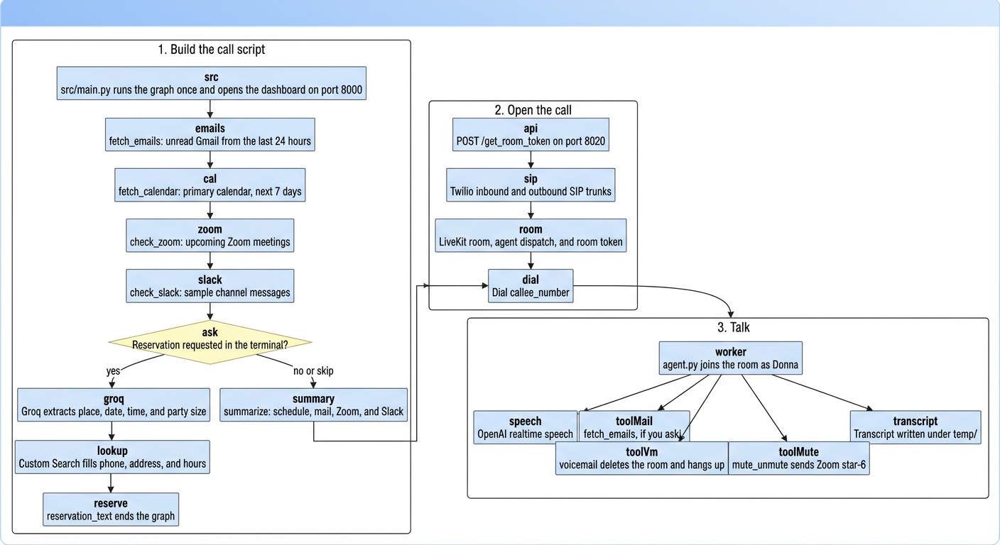
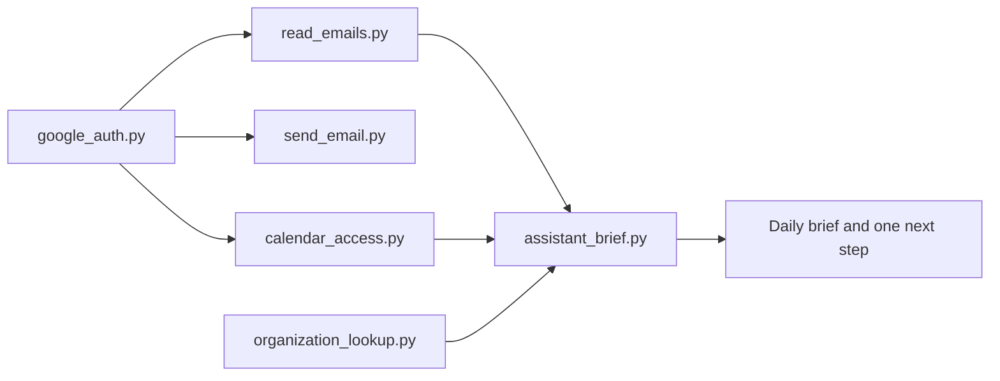

# Donna

Donna is a personal assistant built at SunHacks. She gathers what is on your plate — recent mail, the next week of calendar events, upcoming Zoom meetings, and a reservation request — then places a phone call and talks through it.

The project has two stages that run as separate processes, plus a standalone Google toolkit that is not imported by the call path.



## Methodology

Donna prepares a script before she speaks.

1. Collect the raw sources in a fixed order. Each step writes into one shared state object and records the next step, so a failure in Zoom or Slack still lets the rest of the pass continue.
2. Decide what the call is for. A reservation request becomes the call script. Otherwise the call script is a spoken briefing of schedule, mail, Zoom, and Slack.
3. Hand that script to the phone layer as `call_context`. The voice worker does not re-run the graph. It receives the script in the LiveKit job metadata and talks from it.
4. Keep a person in the loop for reservations. The graph asks in the terminal before it extracts a place, time, and party size. The phone call is the action; the graph does not book the table itself.
5. Let Donna fetch mail again during the call if you ask. That tool reads Gmail directly and does not go back through the graph.

Slack in the current graph is demonstration data filled in by the Slack step. Zoom, Gmail, Calendar, and place lookup are live API calls.

`src/llm/README.md` describes an earlier design with a repeating monitor, conflict detection, and extra analysis nodes. The graph that runs today is the one-pass flow in `src/llm/agent_graph.py`.

## Working pipeline

### 1. Build the call script

`src/main.py` starts a status dashboard on port 8000, then runs `AIVoiceAgent` once. The agent compiles a LangGraph `StateGraph` with an in-memory checkpointer and invokes it a single time.

| Step | What it does |
| --- | --- |
| `fetch_emails` | Unread inbox mail from the last 24 hours through `src/services/gmail.py`. Each message keeps id, subject, sender, a truncated body, and timestamp. Copies are written under `logs/`. |
| `fetch_calendar` | Primary-calendar events for the next 7 days through `src/services/calendar.py`: title, time, location, attendees, status. |
| `check_zoom` | Zoom Server-to-Server OAuth via `src/llm/zoom_auth.py`, then the current user and upcoming meetings (topic, start, duration, join URL). |
| `check_slack` | Four sample channel messages, with an unread count. |
| `make_reservation` | Asks in the terminal. `no` or `skip` continues to the summary. Any other reply is sent to Groq (`llama-3.1-8b-instant`) to extract place, date, time, party size, and special requests. The place name is looked up with Google Custom Search for phone, address, hours, and website. A successful extraction stores `reservation_text` and ends the graph. |
| `summarize` | Counts mail and events, lists today's events and up to ten recent subjects, and carries Zoom and Slack forward. Runs only when there is no reservation script. |

`src/main.py` then turns that state into prose. A reservation becomes a sentence such as the place, time, date, party size, and any phone, address, or hours that were found. Otherwise the prose is a time-of-day greeting plus schedule, email, Zoom, and Slack sections.

That prose is posted to `http://localhost:8020/get_room_token`.

### 2. Open the call

`main.py` is a FastAPI app on port 8020. `POST /get_room_token` accepts the user name, a unique code, optional callee number, meeting id and password, and `call_context`.

For each request it:

1. Builds Donna's instructions: a chief-of-staff persona, plus the reservation or briefing text when one was sent.
2. Creates a Twilio inbound SIP trunk and a matching LiveKit inbound trunk for the user's code.
3. Creates a Twilio outbound trunk and a LiveKit outbound trunk, then dials `callee_number` into a LiveKit room.
4. Creates the LiveKit room, dispatches an agent named `{unique_code}_agent`, and returns a room token (`room_management.py`).
5. Starts `agent.py dev` in the background with `AGENT_NAME` set, so the worker can join that room.

### 3. Talk

`agent.py` is a LiveKit Agents worker. On each job it:

1. Connects to the room for audio only and reads the job metadata (instructions, caller name, outbound context, meeting id).
2. Waits for a participant.
3. Starts an `AgentSession` with Silero voice activity detection, far-field noise reduction, and OpenAI realtime speech (`gpt-4o-mini-realtime-preview` for the conversation, `gpt-4o-mini-tts` for the voice).
4. Runs `MyAgent` (`custom_agent.py`) with those instructions.

Tools available on an outbound call:

- `fetch_emails` reads the last 24 hours of Gmail again through `functions.py`.
- `voicemail` deletes the LiveKit room when the call is going to voicemail, which hangs up.
- `mute_unmute` sends the Zoom mute DTMF sequence (`*6`) when the request includes a meeting id.

When the participant leaves, the worker writes the chat history to `temp/transcript_<room>_<timestamp>_<id>.json`.

### Dashboard

The dashboard started beside the graph is a second FastAPI app from `src/api/web_interface.py`.

| Endpoint | Role |
| --- | --- |
| `GET /dashboard` | Status page |
| `GET /status` | Running flag, current step, counts |
| `POST /start`, `POST /stop`, `POST /force-check` | Control the in-process agent |
| `GET /conflicts`, `GET /important-items`, `GET /interactions` | Views over agent state |
| `POST /simulate-user-response` | Inject a user command |
| `GET /logs` | Tail of the agent log |

The phone call itself is the service on port 8020, not this dashboard.

## Google toolkit

`sunhacks - personal assistant/google_auth/` is the hackathon Gmail, Calendar, and place-lookup toolkit. The voice pipeline uses `src/services/` and the copy of place lookup inside `src/llm/agent_graph.py`. It does not import this folder.



`send_email.py` shares the Gmail sign-in and is not an input to the brief. The brief only reads the dictionaries returned by mail, calendar, and place lookup.

| File | Role |
| --- | --- |
| `google_auth.py` | OAuth for Gmail and Calendar. Scopes are read-only Gmail, send, and Calendar. Tokens are stored in `token.json`. |
| `read_emails.py` | Inbox search by sender, read state, promotions, starred, and important. Returns id, subject, from, and snippet. |
| `send_email.py` | Sends a plain-text message. |
| `calendar_access.py` | Upcoming events in America/Denver, defaulting to today through seven days. |
| `organization_lookup.py` | Custom Search for a place's phone, address, hours, and website. |
| `assistant_brief.py` | Reads those result dictionaries and builds a daily brief: which emails need attention, which events overlap, where the workday has a free gap, how complete a place lookup is, and one suggested next step. It also formats that brief as a short paragraph. |

Sample brief, with no Google sign-in:

```powershell
python "sunhacks - personal assistant/google_auth/assistant_brief.py"
```

Live unread mail, calendar, and a place lookup, using a `token.json` in the current directory:

```powershell
python "sunhacks - personal assistant/google_auth/assistant_brief.py" --live
```

## Repository map

| Path | Role |
| --- | --- |
| `main.py` | Call service on port 8020 |
| `agent.py` | LiveKit voice worker |
| `custom_agent.py` | LiveKit agent class loaded with Donna's instructions and tools |
| `telephony.py` | Twilio SIP trunks and the outbound dial |
| `room_management.py` | LiveKit room, agent dispatch, room token |
| `functions.py` | `fetch_emails` tool used during the call |
| `src/main.py` | One graph run, spoken summary, post to the call service |
| `src/llm/agent_graph.py` | LangGraph nodes and edges |
| `src/llm/agent_runner.py` | `AIVoiceAgent` one-shot runner |
| `src/llm/zoom_auth.py` | Zoom Server-to-Server OAuth and meeting list |
| `src/services/gmail.py` | Gmail client used by the graph and the voice tool |
| `src/services/calendar.py` | Calendar client used by the graph |
| `src/services/data_logger.py` | Writes fetched mail and events under `logs/` |
| `src/api/web_interface.py` | Dashboard on port 8000 |
| `canvas_ics_parser.py` | Standalone Canvas ICS feed reader for the next 7 days. Not called by the graph. |
| `sunhacks - personal assistant/google_auth/` | Standalone Google toolkit and daily brief |
| `sunhacks - personal assistant/zoom_auth/` | Zoom token notes from the hackathon auth work |

## Run the call path

Use a Python environment with the root `requirements.txt` installed. Put secrets in a `.env` file at the repo root. The graph and the voice worker both call `load_dotenv()`.

Expected variables:

```text
LIVEKIT_URL
LIVEKIT_API_KEY
LIVEKIT_API_SECRET
OPENAI_API_KEY
GROQ_API_KEY
ZOOM_ACCOUNT_ID
ZOOM_CLIENT_ID
ZOOM_CLIENT_SECRET
GMAIL_CREDENTIALS_PATH
GMAIL_TOKEN_PATH
CALENDAR_CREDENTIALS_PATH
CALENDAR_TOKEN_PATH
UNIQUE_CODE
BOT_NAME
USER_NAME
```

Gmail and Calendar OAuth client files default to `credentials/gmail_credentials.json` and `credentials/calendar_credentials.json`. Zoom's module reads its account id and client credentials on import, so those three Zoom variables need to be set before the Zoom step runs.

Terminal 1, from the repo root:

```powershell
python main.py
```

Terminal 2, from `src` so the `llm` and `services` imports resolve:

```powershell
python main.py
```

The second process prints the briefing, posts it to port 8020, and leaves the dashboard at `http://localhost:8000/dashboard`. If you answer the reservation prompt with anything other than `no` or `skip`, have `GROQ_API_KEY` set. The call service must already be listening on port 8020.

`client_secret.json`, `token.json`, `.env`, and the `credentials/` directory are gitignored. Keep API keys and telephony secrets there rather than in source.
